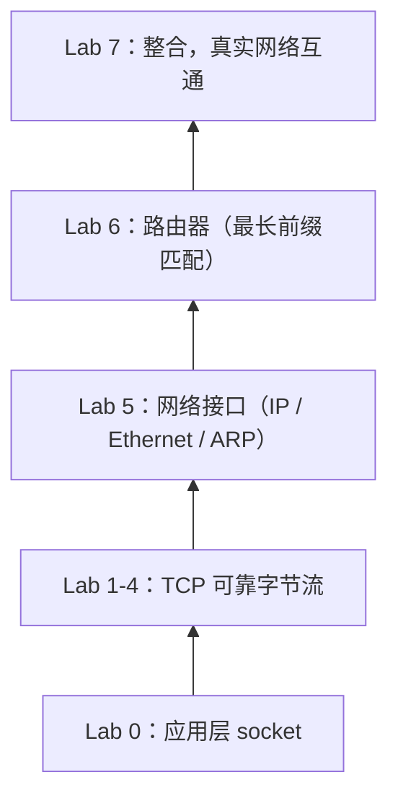

# CS144 学习指南（以 Lab 为主线）

> 适用于以 `lab_handouts/lab0-7.pdf` 为主要材料、课堂讲义按需查阅的学习方式。
> 核心目标：用测试、教材、RFC 和真实网络补足手册的信息缺口，避免知识碎片化。

## 0. 先看全局：Lab 在协议栈中的位置

- **Lab 0**：socket、DNS、HTTP
- **Lab 1–4**：TCP 的分层实现（重组 → 接收 → 发送 → 连接管理）
- **Lab 5**：网络接口与链路层
- **Lab 6**：IP 路由
- **Lab 7**：把自己的协议栈接到真实网络上

每开始一个 Lab，先用 5 分钟回答：

1. 它在协议栈的哪一层、解决什么问题？
2. 它依赖前面哪个 Lab 的什么接口？
3. 它对外保证什么 invariant（不变量）？

把答案写进 `writeups/labN.md` 或自己的笔记。有了这层认识，手册里的细节就不再是孤立的规则。

## 1. 手册读三遍，但目的不同

1. **第一遍只画图**：数据流、状态机、窗口位置，不写代码；
2. **第二遍标接口和边界**：每个函数的输入/输出、SYN/FIN、回绕、空段、重复段、窗口外段；
3. **第三遍才动手**：把每个 “Why am I doing this?” 当作自测题，能用自己的话答出来再写。

遇到手册没讲清的地方，先记进“问题清单”，不要立刻猜——后面用测试、头文件注释或 RFC 验证。

## 2. 即时补充概念（资源映射）

不需要从头刷完讲义。遇到卡点时，只读当前 Lab 相关的一小段：

| Lab | 核心概念 | 本仓库材料 | 外部补充 |
|---|---|---|---|
| 0 | socket / DNS / HTTP | `notes/week-1-how-the-internet-works.pdf` | Beej's Guide；教材应用层 |
| 1 | 可靠传输 / 滑动窗口 / 重组 | `notes/week-1-reliability.pdf` | RFC 9293 §3.3 |
| 2 | seqno / ackno / 窗口 / 状态机 | `notes/week-2-tcp.pdf` | RFC 9293 §3.3–3.8；TCP/IP Illustrated |
| 3 | 重传 / RTO / 流量与拥塞窗口 | `notes/week-2-tcp.pdf`、`notes/week-4-why_congestion_control.pdf` | RFC 6298；RFC 5681 |
| 4 | 连接建立与关闭 / TIME_WAIT / linger | `notes/week-2-tcp.pdf` | RFC 9293 连接管理部分 |
| 5 | 链路层 / Ethernet / ARP | `notes/Ethernet.pdf`、`notes/Link Layer Lecture.pdf` | 教材链路层 |
| 6 | 路由 / 最长前缀匹配 | `notes/Routing Lecture 1.pdf`、`notes/Routing Lecture 2.pdf` | 教材网络层控制平面 |
| 7 | 整合 / 真实网络 | `tun.sh`、`tap.sh`、`txrx.sh` | tcpdump / Wireshark |

使用方式：带着问题读 5–10 页，读完马上回到代码或测试验证。README 中有公开视频列表，适合某个概念反复卡住时看对应的一两讲。

## 3. 把测试当作第二份手册

`tests/` 里的 FSM harness 和用例比手册更精确地定义了边界。建议：

- 读测试源码，理解它如何构造 `TCPSegment`、如何期望 ackno / window；
- 把失败信息翻译成不变量（例如“ackno 少 1 说明 FIN 没有计入序列空间”）；
- 自己补几个手册没覆盖的用例：SYN+FIN 无 payload、纯 ACK、重复 FIN、窗口外段。

这比反复读文字更能建立“规格 → 代码 → 行为”的对应关系。

## 4. 用真实网络做现象对照

- `tcpdump -i lo -nn` 或 Wireshark 抓一次 `curl` / `nc` 的连接，观察三次握手、seq/ack、重传、窗口；
- `ss -ti` 看 cwnd、rtt、重传计数；
- 到 Lab 7 时用 `tun.sh` 跑自己的协议栈，再抓包对比。

每个概念尽量找到一个“可观察现象”，理论就不会悬空。

## 5. 用考试题做检索练习

`exams/midterm` 和 `exams/final` 都带答案，是现成的自测材料：

- Lab 0–4 结束后做期中题，Lab 5–7 结束后做期末题；
- 先闭卷写，再对答案，把错题归因到具体 Lab 的概念；
- 隔一周再重做错题（间隔重复比当场重看有效）。

## 6. 卡住时的处理顺序

1. 用一句话复述问题，确认自己卡在“概念”还是“实现细节”；
2. 构造最小例子手算（例如 `unwrap` 的 checkpoint=0、SYN+FIN 无 payload）；
3. 看头文件注释、Doxygen 文档和测试期望；
4. 查 RFC 或教材的对应段落；
5. 问 AI 要提示和诊断，不要直接要答案（参见项目记忆 `learning-with-ai.md`）；
6. 把结论写进问题清单或 `writeups/labN.md`，避免下次再卡。

## 7. 每个 Lab 的固定节奏

1. 读手册 + 对应 slides 的相关部分（30–60 分钟）
2. 写一页设计和不变式清单
3. 实现并跑 `make check_labN`
4. 用 tcpdump / 日志验证至少一个行为
5. 做 2–3 道相关考题
6. 更新 `writeups/labN.md`（设计、挑战、遗留 bug）

## 8. 推荐材料清单

- **本仓库**：`README.md` 的视频列表、`notes/` 讲义、`lab_handouts/` 手册、`tests/` 测试、`exams/` 历年题
- **教材**：Kurose & Ross《Computer Networking: A Top-Down Approach》（重点：运输层、网络层、链路层）
- **进阶**：Stevens《TCP/IP Illustrated, Vol. 1》
- **RFC**：9293（TCP）、6298（RTO）、5681（拥塞控制）、1071（校验和）
- **工具**：Wireshark / tcpdump、`ss`、Beej's Guide to Network Programming

信息源优先级建议：

**handout → 头文件/项目文档 → 测试 → RFC → 教材/讲义 → 博客/现成实现**

博客和现成实现能快速解决问题，但也最容易跳过推导过程。以 Lab 为主线、按需补概念，配合测试与真实网络验证，既能保留问题驱动学习的动机，也能补齐手册信息有限的短板。
